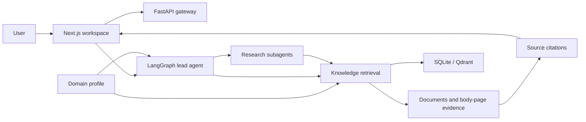

# Hilo

**Connect your documents. Follow the evidence.**

Hilo is an extensible **Agentic RAG and knowledge research framework** for building
assistants that retrieve source material, answer with traceable citations, and
coordinate deeper research when explicitly requested.

[简体中文（默认）](README.md) · **English** · [Architecture](docs/architecture.md) ·
[Domain profiles](docs/domain-profiles.md) · [Contributing](CONTRIBUTING.md)

> Early-stage framework. Hilo builds on [DeerFlow](https://github.com/bytedance/deer-flow)
> and retains its upstream MIT license and attribution. It is a full-stack source
> project; a standalone stable Python SDK is not yet provided.

## What Hilo provides

- **Document-grounded answers:** catalog routing, full-document body-page search,
  page/paragraph location, and numbered source citations.
- **Two research paths:** bounded direct retrieval for ordinary questions; lead-agent
  routing and delegated evidence gathering for explicit deep-research requests.
- **Domain profiles:** YAML instructions, aliases, query facets, and rewrite rules,
  shared by retrieval, the lead agent, and research subagents.
- **Knowledge workspace:** document upload, personal knowledge spaces, annotations,
  and a streaming chat interface.
- **Extensibility:** configure model providers, add Skills, and integrate MCP tools
  using the inherited agent runtime.
- **Evidence controls:** exclude navigation pages as body evidence, preserve source
  scope, track citations, and expose gaps rather than fabricate missing information.

Hilo's reusable layer is separate from the subject matter. The technical-documentation
example includes synthetic source documents; the fiscal-history profile demonstrates
how the original application can be expressed as configuration, without shipping books.

## Quick start

Requires **Docker with Compose**, Git, and Python 3.12+ for the setup helper.
Model and embedding calls require your own compatible provider credentials.

```bash
git clone https://github.com/weiji6/hilo.git
cd hilo
make config
```

Edit `backend/.env` and set `OPENAI_API_KEY`. The template uses an OpenAI-compatible
chat model and embeddings; change `OPENAI_MODEL`, `OPENAI_BASE_URL`,
`EMBEDDING_MODEL`, and `EMBEDDING_BASE_URL` for your provider.

```bash
make docker-start
make index-knowledge
```

Open **http://localhost:2026**, create a local account, and ask about the example
worker's retry policy. Initial image builds and dependency downloads can take time.
The stack includes the frontend, API gateway, LangGraph development runtime,
MariaDB for login, Qdrant, and nginx. It binds the web entry point to localhost.

`make config` creates local config files, generates a random authentication secret,
selects the technical-documentation profile, and copies synthetic example documents.
It preserves existing files. If you already have `config.yaml`, select the profile
there manually. The source files in `examples/` remain unchanged.

Stop the stack with `make docker-stop`. Named volumes persist runtime data,
checkpoints, the authentication database, and vectors across ordinary restarts.
This is a local development setup, not a hardened public deployment template.
See [SECURITY.md](SECURITY.md) before hosting it beyond your machine.

## Adapt Hilo to your domain

Start with a YAML profile:

```yaml
# examples/my-domain/domain.yaml
name: my-domain
instructions: |
  State the applicable version and cite the source for each factual claim.
  Distinguish current behavior from proposals and unresolved questions.
query_aliases:
  SSO: [single sign-on]
query_suffixes: [configuration, limitations]
```

Select it in your local `config.yaml`:

```yaml
domain:
  profile: examples/my-domain/domain.yaml
```

Add documents to `knowledge/docs/`, index them, and restart the backend after
changing the profile. Profile paths are relative to the application configuration.
In Docker, mount additional profile directories if they are outside `examples/`.
The default `domain: {name: general}` adds no subject-specific query expansion.

Included examples:

| Example | Demonstrates |
| --- | --- |
| [Technical documentation](examples/technical-docs/) | Version-aware answers, retry rules, unknown metrics, synthetic documents |
| [Fiscal history](examples/fiscal-history/) | Historical-period aliases, fiscal query facets, source-scope guidance |

Profiles are process-wide administrator configuration; they are not selected
independently per conversation. See [domain profiles](docs/domain-profiles.md)
for all fields, scope guarantees, and limitations.

## Architecture



## Document and tool support

The default configuration includes retrieval, `ls`, `read_file`, `bash`, web fetch,
and image search. File reading enables progressive Skills loading. Web/image tools
require external network services. Deep-research agents retain their scoped tool
allowlists. LocalSandbox executes commands on the backend host/container; optional
AIO and [Kubernetes provisioner](docker/provisioner/README.md) deployments require
additional configuration and are not started by the default Compose stack.

From `backend/`, using the backend dependency environment:

```bash
uv run python ../scripts/ingest_structured_docs_to_db.py --docs-dir ../knowledge/docs
uv run python ../scripts/prewarm_knowledge_indexes.py
uv run python scripts/local_ocr.py --input /path/to/pdfs --output /path/to/output \
  --grpc-target 127.0.0.1:50051
```

The ingestion helper populates SQLite paragraphs/FTS from `.structured.json`;
`make index-knowledge` builds Qdrant vectors. OCR requires a separate compatible
MinerU gRPC service and moves processed PDFs into `output/done`. Place OCR results
in the knowledge corpus and ingest/index them separately. See the
[functionality audit](docs/functionality-audit.md) for restored tooling and limits.
Full Docker startup, live-model answers, and external OCR still require validation
in the target environment.

The lead agent selects sources. Ordinary questions retrieve evidence directly;
explicit research tasks can delegate bounded work. Child results are synthesized
with their citation registry. Skills, MCP, model configuration, and sandbox
providers remain extension points inherited from DeerFlow.

## Development and validation

Requires Python 3.12+, uv, Node.js 22+, and pnpm 10.26.2.

```bash
make install
make test
cd frontend && pnpm typecheck
```

`make test` runs the framework regression suite: domain isolation, setup and
publication guards, bounded retrieval, source evidence, catalog routing,
citation behavior, optional task-memory handling, and publication completeness.
It is not the entire inherited suite or a live-service end-to-end acceptance test. Some inherited tests
require additional provider/parser dependencies; see [CONTRIBUTING.md](CONTRIBUTING.md).

Use `python3 scripts/export_open_source.py --check` to inspect publication inputs.
`make export` creates a new source-only snapshot in `release/hilo`, excluding
Git history, local settings, runtime data, private infrastructure, and demo recordings.
The exporter refuses to overwrite an existing destination. It distributes source;
it does not migrate or preserve a repository’s Git commit history.

## Current scope

Hilo supports configurable domains, document-based research, and a full-stack
workspace today. A stable standalone SDK, per-request domain switching, formal
retrieval-quality benchmarks, and production API authorization remain future work.
Citation checks verify source registration and page type; they do not prove every
claim is semantically entailed by the cited passage. Model behavior still needs
application-specific evaluation.

## Attribution and license

Hilo is derived from **DeerFlow** by ByteDance and its contributors. Its inherited
agent runtime includes orchestration, Skills, MCP integration, memory, and sandbox
infrastructure. Hilo focuses on configurable knowledge retrieval and evidence-based
research workflows. See [NOTICE](NOTICE) and [LICENSE](LICENSE) for attribution
and the MIT license. Third-party dependencies and bundled skills retain their
respective licenses.
