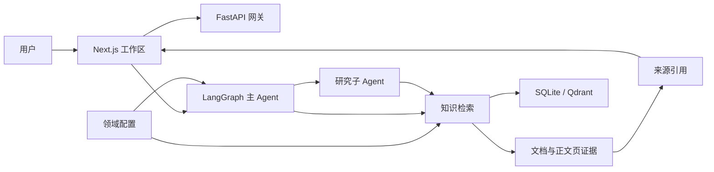

# Hilo

**连接文档，循证探索。**

Hilo 是一个可扩展的 **Agentic RAG 与知识研究框架**。它让 Agent 接入专业文档，
定位正文证据，以可追溯的引用回答问题，并在用户明确要求深入研究时协调研究子任务。

**简体中文** · [English](README.en.md) · [架构说明](docs/architecture.md) ·
[领域配置](docs/domain-profiles.md) · [参与贡献](CONTRIBUTING.md)

> 项目处于早期阶段，基于 [DeerFlow](https://github.com/bytedance/deer-flow) 发展，
> 保留上游 MIT 许可证与贡献者署名。目前提供完整的前后端源码，尚未提供独立、稳定的 Python SDK。

## 核心能力

- **基于文档的问答**：通过目录路由选择来源，检索整篇文档的正文页，定位页码与段落，生成编号引用。
- **两条研究路径**：普通问题采用有预算限制的直接检索；明确的深度研究请求可分配来源范围内的研究子任务，再汇总证据。
- **领域配置**：用 YAML 定义领域指令、术语别名、检索侧重点与改写规则，由检索层、主 Agent 和研究子 Agent 共同使用。
- **知识工作区**：文档上传、个人知识空间、批注与流式对话界面。
- **扩展能力**：配置不同模型服务，通过 Skills、MCP 工具及沙箱扩展 Agent 的能力。
- **证据约束**：区分目录导航页与正文证据，保持来源范围，登记引用，并在证据不足时说明缺口。

通用框架与具体领域分离。技术文档示例附带虚构的演示文档；财经史示例展示如何通过配置
表达原应用的领域规则，不附带原书、用户资料或私有部署配置。

## 快速开始

需要 **Docker 与 Compose**、Git，以及运行初始化脚本的 Python 3.12+。
模型与向量嵌入调用需要你自己的兼容服务凭据。

```bash
git clone https://github.com/weiji6/hilo.git
cd hilo
make config
```

编辑 `backend/.env`，填写 `OPENAI_API_KEY`。模板使用兼容 OpenAI 的对话模型和嵌入服务，
可按服务商修改 `OPENAI_MODEL`、`OPENAI_BASE_URL`、`EMBEDDING_MODEL` 和 `EMBEDDING_BASE_URL`。

```bash
make docker-start
make index-knowledge
```

打开 **http://localhost:2026**，注册本地账号，尝试询问示例 worker 的重试策略。
首次构建镜像和下载依赖可能需要较长时间。默认栈包括前端、API 网关、LangGraph 开发运行时、
登录使用的 MariaDB、Qdrant 与 nginx；Web 入口绑定本机地址。

`make config` 会创建本地配置、生成随机认证密钥、选择技术文档领域配置，并复制虚构示例文档。
已有文件会保留；如果你已经有 `config.yaml`，需要手动选择其中的领域配置。
`examples/` 中的原始示例文件不会被修改。

使用 `make docker-stop` 停止服务。命名卷会保留运行数据、检查点、认证数据库与向量索引。
这是一套本地开发配置；对外部署前请阅读 [SECURITY.md](SECURITY.md)。
完整 Docker 启动、真实模型回答与外部 OCR 服务仍需要在目标环境中验证，见[功能核对记录](docs/functionality-audit.md)。

## 接入自己的领域

先创建领域 YAML：

```yaml
# examples/my-domain/domain.yaml
name: my-domain
instructions: |
  回答时说明适用版本，为事实性结论引用来源。
  区分当前行为、提案和尚未解决的问题。
query_aliases:
  SSO: [single sign-on, 单点登录]
query_suffixes: [配置, 限制]
```

在本地 `config.yaml` 中选择它：

```yaml
domain:
  profile: examples/my-domain/domain.yaml
```

把文档放入 `knowledge/docs/` 并建立索引；修改领域配置后重启后端。
领域配置的相对路径以应用 YAML 所在目录为基准。Docker 中使用 `examples/` 以外的配置目录时，
需要增加对应挂载。默认 `domain: {name: general}` 不添加任何特定领域的查询扩展。

| 示例 | 展示内容 |
| --- | --- |
| [技术文档](examples/technical-docs/) | 版本约束、重试规则、未知指标处理与虚构源文档 |
| [财经史](examples/fiscal-history/) | 历史时期别名、财经检索侧重点与来源范围约束 |

领域配置由管理员在进程级加载，目前不能为每段对话独立切换。
全部字段、作用范围与限制见[领域配置文档](docs/domain-profiles.md)。

## 文档处理与扩展工具

默认配置包含知识检索、`ls`、`read_file`、`bash`、网页抓取和图片搜索。
文件读取用于按需加载 Skills；网页与图片工具需要相应外部网络服务。
深度研究路径仍限制研究子 Agent 的工具与来源范围。MCP 通过本地扩展配置接入。

本地沙箱会在后端主机或容器内执行命令。需要隔离执行环境时，可配置继承自 DeerFlow 的
AIO 沙箱或 [Kubernetes provisioner](docker/provisioner/README.md)；它们不随默认 Compose 自动启动。

结构化文档与 OCR 的配套命令也包含在源码中：

```bash
# 从项目根目录运行；使用后端依赖环境
cd backend
uv run python ../scripts/ingest_structured_docs_to_db.py --docs-dir ../knowledge/docs
uv run python ../scripts/prewarm_knowledge_indexes.py
# PDF OCR 需要另外部署兼容的 MinerU gRPC 服务；成功后源 PDF 会移入 output/done
uv run python scripts/local_ocr.py --input /path/to/pdfs --output /path/to/output \
  --grpc-target 127.0.0.1:50051
```

入库脚本把 `.structured.json` 写入 SQLite 段落库，供正文定位和全文检索使用；
`make index-knowledge` 则建立 Qdrant 向量索引。OCR 产物还需要放入知识库并执行入库/索引，
不能仅运行 OCR 就视为完成知识接入。维护工具与验证边界见[功能核对记录](docs/functionality-audit.md)。

## 架构



主 Agent 先选择来源。普通问题直接检索证据；明确的深度研究任务可以分派有范围限制的工作，
最后连同引用登记表汇总。Skills、MCP、模型配置与沙箱保留为继承自 DeerFlow 的扩展点。

## 开发与验证

需要 Python 3.12+、uv、Node.js 22+ 与 pnpm 10.26.2。

```bash
make install
make test
cd frontend && pnpm typecheck
```

`make test` 运行框架回归测试，覆盖领域隔离、初始化与导出约束、检索预算、正文证据、
目录路由、引用、可选任务记忆及发布完整性。它不等于全部历史测试或真实服务端到端验收。
部分继承测试依赖额外模型/解析服务；详见 [CONTRIBUTING.md](CONTRIBUTING.md)
与[功能核对记录](docs/functionality-audit.md)。

运行 `python3 scripts/export_open_source.py --check` 检查发布输入。
`make export` 在 `release/hilo` 创建新的纯源码快照，排除 Git 历史、本地设置、运行数据、
私有基础设施及原演示录屏；目标目录已存在时拒绝覆盖。
这套导出流程用于源码分发，不用于保留或迁移原仓库的 Git 提交历史。

## 当前范围

Hilo 已提供可配置领域、文档研究与完整工作区源码。
独立稳定 SDK、按请求切换领域、正式检索质量基准与生产 API 鉴权仍在规划中。
引用检查验证来源登记与页面类型，不保证每条结论在语义上都被引文支持；
模型回答质量需要结合具体应用评估。

## 来源与许可证

Hilo 基于字节跳动及其贡献者的 **DeerFlow** 发展，继承了 Agent 编排、Skills、MCP、记忆与沙箱基础设施。
Hilo 的扩展重点是可配置的知识检索与基于证据的研究流程。个人账号持有本仓库不改变上游代码的署名与许可要求。
详见 [NOTICE](NOTICE) 与 [LICENSE](LICENSE)。第三方依赖与内置 Skills 保留各自许可证。
